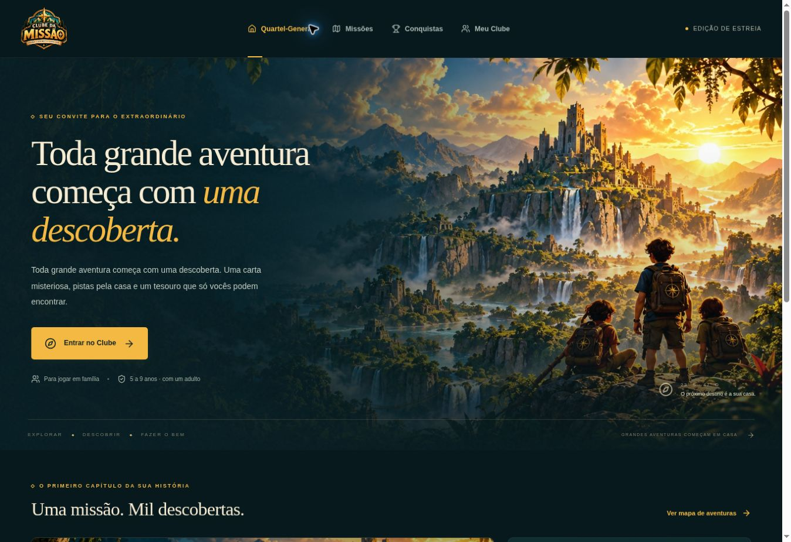

# Clube da Missão

Protótipo funcional de uma aventura familiar em casa. Next.js App Router, React, TypeScript, Tailwind CSS e Motion. Não usa login, pagamentos, publicidade nem serviços de backend.

## Executar

Node.js 24 e npm.

```sh
npm ci
npm run dev
```

`npm run lint`, `npm run typecheck`, `npm test` e `npm run build` verificam o projeto. A Vercel detecta o Next.js automaticamente. Não são necessárias variáveis de ambiente.

## Experimentar a missão completa

1. Entre no Clube e cadastre de um a três apelidos.
2. Abra a missão, selecione um aventureiro ou uma equipe e prepare a aventura.
3. O responsável imprime (ou copia) as seis pistas e prepara os esconderijos do guia. A confirmação de responsável é apenas uma pausa de interface, não autenticação.
4. Encontre cada cartão e digite o código no app antes de resolver seu desafio. Use as dicas quando precisar.
5. Registre cada descoberta para salvar o progresso. Ao completar as seis etapas, imprima o certificado personalizado.

A biblioteca abre documentos HTML completos, imprimíveis pelo navegador. Para PDF, escolha **Imprimir / Salvar como PDF**. O botão de download salva uma cópia HTML; não finge gerar um arquivo PDF. Os assets originais enviados estão em `public/assets`. A logo não foi redesenhada. Os objetos são exibidos por recortes SVG das pranchas originais.

## Arquitetura

- `src/lib/adventure.ts`: missão, validação, perfis, equipes, conquistas e recuperação dos dados locais.
- `src/lib/materials.ts`: materiais personalizados e impressão.
- `src/components/club-app.tsx`: telas, onboarding e jogo.
- `src/components/asset.tsx`: objetos ilustrados originais.
- `src/lib/avatars.ts` e `src/components/profile-avatar.tsx`: catálogo dos dez personagens, migração dos avatares anteriores e retratos reutilizáveis.
- `src/app/globals.css`: tokens visuais, responsividade e redução de movimento.
- `tests/`: validações da progressão e persistência.

O progresso é independente por aventureiro ou combinação de equipe e usa `localStorage` (`clube-da-missao:v1`). Não é sincronizado entre aparelhos e pode ser apagado pela limpeza do navegador. Uma nova equipe inicia do zero; voltar à mesma equipe recupera a expedição. O diário e o certificado são compartilhados pelos participantes da equipe ativa. Perfis podem ter o nome e o avatar editados pelo responsável. Há dez retratos ilustrados de personagens, gerados individualmente e otimizados para a interface. A exclusão de perfis tem confirmação, pode ser desfeita antes de salvar e remove somente as expedições que incluíam o perfil excluído. Excluir todos os perfis retorna à entrada do Clube. Os avatares da primeira versão são migrados automaticamente, mantendo nomes e progresso. Não há rankings entre crianças.

O mapa é narrativo; os esconderijos físicos são os do guia. Aventuras futuras aparecem como **Em breve**. Nenhuma funcionalidade de compra ou desbloqueio pago foi simulada.

## Prévia



## Kit de impressão

A preparação e a biblioteca oferecem PDFs A4 finais em `public/materiais`: seis pistas em três folhas, versão econômica, guia de três páginas, carta-convite e diário de quatro páginas. A carta é opcional; o cartão 1 começa o jogo. O certificado continua personalizado pelo navegador. Os cartões e o guia também são abertos pelos botões anteriores.

Para regenerar os PDFs: `python scripts/build-materials.py` (ReportLab e pypdf instalados; dependências npm instaladas). O script importa STEPS diretamente do jogo; não duplique os desafios em outro arquivo. A carta-convite original fica em `public/materiais/carta-convite.jpg`.

O aplicativo ainda usa persistência local e não possui autenticação ou liberação de acesso vinculada à compra. Os PDFs publicados são acessíveis por URL; não representam controle de acesso ao order bump.
